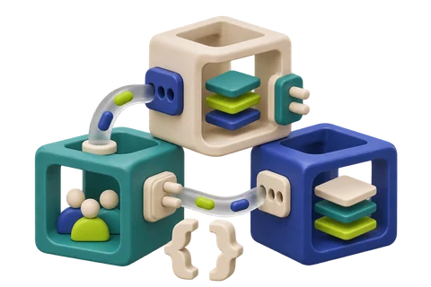

# M. A. Leli

**I build the parts of web apps that make the workflow hold together.**

I’m a software developer in Nairobi. I work across the database, API, and interface, and I’m most interested in what happens between screens. Who can move an application forward? What needs to happen to stock when a sale goes through? Which parts of the next admin screen can reuse what’s already there?

[Portfolio](https://m-a-leli.com/en) · [Email me](mailto:m.lelialvin@gmail.com)

## Selected projects

  
  
  

### [Nia Beauty](https://nia-beauty.m-a-leli.com/) · Commerce

A cosmetics storefront with ingredient information alongside the shopping journey. This is my Laravel, PostgreSQL, and Angular example for taking a product catalogue through to checkout.

### [InternSync](https://internsync.m-a-leli.com/) · Internship workflows

A platform for students looking for internships and organizations managing placements. The engineering question I find interesting here is how the same application looks to a student, an organization, and a university.

### [OSAPIS](https://osapis.m-a-leli.com/) · Developer tooling

A catalogue of backend APIs for developers building frontends. If you’re wiring up a form or a data view, start here to find an API you can experiment with.

### [TenanCyX](https://tenancyx.m-a-leli.com/) · Inventory and point of sale

Connects wholesale supply, inventory, and retail sales. The interesting part is following stock across those workflows as it moves from supplier to shop to customer.

### [Venyto](https://venyto.m-a-leli.com/) · Events

A platform for discovering and organizing events. I’m interested in where those two journeys meet, from what an organizer needs to publish to what an attendee needs to discover.

### [Nestsy](https://nestsy.m-a-leli.com/) · Rentals

A product that brings property discovery and rental management together. Finding a place and managing a rental are different workflows built around the same property, which makes the data model an interesting part of the work.

## How I build

- **APIs and application logic** with Laravel and PHP or Node.js, Express, and TypeScript. I’m especially interested in how validation and permissions fit into multi-step workflows.
- **Interfaces** with Angular and TypeScript. I look for patterns that can be shared across forms, lists, and record-management screens.
- **Data and deployment** with PostgreSQL, MySQL, and Docker. I care about how the application fits together all the way through deployment.

If you’re working on a tricky workflow or a tool that makes repetitive application work easier, [I’d like to hear about it](mailto:m.lelialvin@gmail.com).
