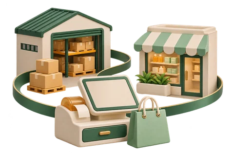

# M. A. Leli

**Full-stack developer. Backend by inclination.**

The part of a project I like most is where a product rule becomes a software decision. In a placement workflow, who can take the next action? In a point-of-sale system, what should happen to stock when a sale goes through? I build across the database, API, and interface to make those answers agree.

[Portfolio](https://m-a-leli.com/en) · [Email](mailto:m.lelialvin@gmail.com)

## Project gallery

<table>
  <tr>
    <td width="50%" valign="top">
      <a href="https://nia-beauty.m-a-leli.com/"> <strong>Nia Beauty</strong></a>
      
A cosmetics storefront that keeps ingredient information alongside the shopping journey. Laravel and PostgreSQL behind an Angular storefront.

    </td>
    <td width="50%" valign="top">
      <a href="https://internsync.m-a-leli.com/"> <strong>InternSync</strong></a>
      
Internship discovery and placement management. Students, organizations, and universities each see the same placement process from a different role.

    </td>
  </tr>
  <tr>
    <td width="50%" valign="top">
      <a href="https://osapis.m-a-leli.com/"> <strong>OSAPIS</strong></a>
      
A catalogue of APIs for developers who want a backend to learn or prototype against. A starting point for wiring up a frontend, a form, or a data view.

    </td>
    <td width="50%" valign="top">
      <a href="https://tenancyx.m-a-leli.com/"> <strong>TenanCyX</strong></a>
      
Point of sale, inventory, and supply-chain workflows for wholesalers and retailers. Follow a product from wholesale supply to the retail sale.

    </td>
  </tr>
  <tr>
    <td width="50%" valign="top">
      <a href="https://venyto.m-a-leli.com/"> <strong>Venyto</strong></a>
      
Event discovery and management. The organizer publishes an event, and the attendee needs enough information to decide whether to go.

    </td>
    <td width="50%" valign="top">
      <a href="https://nestsy.m-a-leli.com/"> <strong>Nestsy</strong></a>
      
Property search and rental management. A property record has to serve people looking for a place and people managing it afterwards.

    </td>
  </tr>
</table>

## A closer look at how I build

**I start with the workflow.** For a placement or an inventory movement, I want to understand who initiates it, what changes in the database, and which actions become available next. That gives me something concrete to model before writing the API.

**I treat permissions as part of the API design.** In one Laravel and Angular design, the server enforces permissions and gives the UI just the capabilities it needs at each level. Global access controls navigation, collection capabilities apply to the list as a whole, and record-specific actions appear when you open the record. That keeps the list payload smaller and makes it clear where each decision belongs.

**I reuse the common parts of admin screens.** Configurable Angular lists and forms are a problem I keep coming back to. Once several screens share the same behavior, I look for a common component with room for the exceptions that each workflow needs.

My usual tools are **Laravel and PHP** or **Node.js and Express** for APIs, **Angular and TypeScript** for interfaces, and **PostgreSQL, MySQL, and Docker** for data and deployment.

If you’re working on an API, a workflow with several roles, or tooling that makes the next application easier to build, [send me the problem you’re trying to solve](mailto:m.lelialvin@gmail.com).
